# AI-Powered HR Outreach Automation (n8n)

An end-to-end [n8n](https://n8n.io) workflow that turns a company name into personalized, ready-to-review outreach emails for HR and talent acquisition contacts. No manual searching, copying or drafting.

You enter a company name in a form. The workflow finds HR contacts, stores them in Google Sheets, reads your resume from Google Drive, uses Gemini to write a tailored email for each contact, and saves every email as a Gmail draft. When the run finishes, you get a completion email.

> Nothing is sent to recruiters automatically. Every email lands in Gmail Drafts so you can review it first.

---

## Demo

### Video walkthrough

[](https://www.youtube.com/watch?v=iOFwlvI3_4c)

*Click the image to watch the full workflow run, from submitting the form to reviewing the drafts.*


### 1. Workflow on the n8n canvas

The complete pipeline: scraping, storage, resume extraction, AI drafting and notification.


### 2. Input form

The workflow starts here. Enter the company you want to target and submit.


### 3. Google Sheet: contact database

Every HR contact found by the scraper is stored here, with a `Status` column to track outreach.


### 4. Gmail draft: personalized email

Each contact gets a unique email written by Gemini and saved as a draft for review.


---

## The Problem

Reaching out to recruiters is one of the most effective ways to get noticed, especially for students and fresh graduates, but doing it by hand is slow and repetitive:

- **Finding the right people takes hours.** Searching LinkedIn for HR and talent acquisition contacts at each company, one profile at a time, does not scale.
- **Contact details get scattered.** Names, emails and profile links end up in notes, tabs and spreadsheets, with no clear record of who was already contacted.
- **Generic emails get ignored.** Copy-pasting the same message to everyone is quick but rarely gets replies, while writing a personal email for each contact takes too long.
- **Duplicates and mistakes creep in.** It is easy to email the same recruiter twice or send the wrong resume version.
- **The process is hard to repeat.** Every new company means starting the whole routine again from scratch.

## The Solution

This workflow automates the repetitive parts and keeps the human decision where it matters:

| Problem | How the automation solves it |
|---|---|
| Hours of manual searching | Apify scrapes HR and talent acquisition contacts from a single company name |
| Scattered contact data | Everything is cleaned and stored in one Google Sheet |
| Emailing the same person twice | Append-or-update logic and a `Status` column prevent duplicates and repeat outreach |
| Generic, copy-pasted emails | Gemini writes a unique email for each contact using their role, company and your resume |
| Outdated resume details | The resume is read from Google Drive on every run, so updating one file updates every email |
| Risk of sending a bad email | Emails are saved as Gmail drafts, so each one is reviewed before sending |
| Not knowing when the run finished | A completion email tells you when all contacts have been processed |
| Repeating the process for each company | Enter a new company name in the form and the whole pipeline runs again |

**Result:** a task that used to take hours of searching, copying and writing is reduced to filling in one form and reviewing a set of drafts.

---

## Features

- **Form-based input:** start a run by entering a target company name.
- **Automated HR discovery:** Apify actors find HR and talent acquisition professionals and collect name, title, company, location, email and LinkedIn URL.
- **Data cleaning:** JavaScript Code nodes standardize the scraped data.
- **Duplicate-free storage:** Google Sheets uses append-or-update logic, so rerunning the workflow never creates repeated rows.
- **Score and status filtering:** only relevant contacts who have not been emailed yet move forward.
- **Resume extraction:** the resume PDF is downloaded from Google Drive and converted to text.
- **AI-personalized emails:** Gemini combines each contact's details with your resume to write a short, tailored message.
- **Gmail drafts:** each email is saved as a draft with your resume link included.
- **Completion notification:** a summary email confirms when all contacts have been processed.

---

## Workflow Overview

```mermaid
flowchart LR
    A[On form submission] --> B[Apify: company lookup]
    B --> C[Code: clean company data]
    C --> D[Apify: HR contact scraper]
    D --> E[Code: clean HR data]
    E --> F[Google Sheets: append or update]
    F --> G[Filter]
    G --> H[Download resume<br/>Google Drive]
    H --> I[Extract from File<br/>PDF to text]
    G --> J[Loop Over Items]
    I -.resume text.-> K
    J -->|loop| K[Gemini: write email]
    K --> L[Gmail: create draft]
    L --> M[Wait]
    M --> J
    J -->|done| N[Gmail: completion email]
```



### Node breakdown

| Stage | Node | Purpose |
|---|---|---|
| Trigger | On form submission | Collects the company name |
| Scraping | Run an Actor and get dataset (x2) | Finds the company, then scrapes HR contacts |
| Cleaning | Code in JavaScript (x2) | Formats and trims scraped results |
| Storage | Google Sheets (append or update) | Saves contacts without duplicates |
| Filtering | Filter | Keeps relevant, not-yet-contacted rows |
| Resume | Google Drive + Extract from File | Downloads the PDF and extracts its text |
| Iteration | Loop Over Items | Processes one HR contact at a time |
| AI | Gemini (Message a model) | Writes a personalized email per contact |
| Email | Gmail (Create a draft) | Saves each email as a draft |
| Throttle | Wait | Keeps API calls within rate limits |
| Notify | Gmail (Send a message) | Sends the "run complete" email |

---

## Tech Stack

- [n8n](https://n8n.io) (workflow automation)
- [Apify](https://apify.com) (web scraping)
- Google Sheets (contact database)
- Google Drive (resume storage)
- Google Gemini (email generation)
- Gmail (drafts and notifications)

---

## Prerequisites

- An n8n instance (cloud or self-hosted)
- An Apify account and API token
- A Google account with Sheets, Drive and Gmail access (OAuth credentials in n8n)
- A Google Gemini API key
- Your resume as a PDF in Google Drive

---

## Setup

1. **Import the workflow**
   Download `workflow.json` from this repo. In n8n, open a blank workflow and use **Import from File** (or paste with `Ctrl/Cmd + V`).

2. **Add credentials** in n8n for Apify, Google Sheets, Google Drive, Gmail and Gemini, then select them on each node.

3. **Prepare the Google Sheet** with these columns:

   | firstName | lastName | title | company | location | linkedinUrl | score | email | Status |
   |---|---|---|---|---|---|---|---|---|

   Set `email` as the matching column in the "Append or update row" node. `Status` should default to `false`.

4. **Upload your resume** to Google Drive and select it in the Download file node. Set sharing to **Anyone with the link (Viewer)** so recruiters can open it.

5. **Configure the Gemini prompt** (see below) and the Gmail node fields.

6. **Unpin all nodes** (purple pins), then run one test end to end.

7. **Activate** the workflow and open the form URL to start a run.

---

## Gemini Prompt

```
You are helping a job seeker write a short, personalized cold outreach email to an HR recruiter.

HR name: {{ $('Loop Over Items').item.json.firstName }} {{ $('Loop Over Items').item.json.lastName }}
Title: {{ $('Loop Over Items').item.json.title }}
Company: {{ $('Loop Over Items').item.json.company }}

Candidate resume:
{{ $('Extract from File').first().json.text }}

Write the email body only (no subject line).
- 90 to 120 words, plain and conversational, no buzzwords
- Address the HR by first name
- Say I'm a final-year B.Tech student looking for entry-level software roles
- Mention 2 relevant skills or projects from the resume
- Use only facts from the resume
- Do NOT mention grades, SGPA, CGPA or entrance exam scores
- Do NOT claim I've "followed" the company
- Mention that my resume link is below
- End by asking for a short call or the right team to contact
- Sign off with my name
```

Replace the college, batch and sign-off with your own details.

---

## Gmail Node Settings

| Field | Value |
|---|---|
| Operation | Create a draft |
| To | `{{ $('Loop Over Items').item.json.email }}` |
| Subject | `Entry-Level Software Roles at {{ $('Loop Over Items').item.json.company }}` |
| Message | `{{ $json.content.parts[0].text }}` followed by your resume, LinkedIn and GitHub links |

Example message field:

```
{{ $json.content.parts[0].text }}

Resume: https://drive.google.com/file/d/YOUR_FILE_ID/view
LinkedIn: https://www.linkedin.com/in/your-profile
GitHub: https://github.com/your-username
```

---

## Customization Ideas

- Change the Filter conditions (score threshold, location, title keywords).
- Update the Gemini prompt for internships, full-time roles or a specific tech stack.
- Add a Google Sheets **Update row** node after the draft step to set `Status` to `true`.
- Replace Create a draft with Send once you trust the output.
- Add an Aggregate node before the completion email to list every contact processed.

---

## Known Limitations

- Scraping uses Apify credits, so keep the result limit modest while testing.
- Scraped emails can be missing or inaccurate, so check the sheet before sending.
- Gemini only knows what is in the resume. Review each draft for accuracy.
- Pinned data in n8n hides real behavior during testing, so unpin before full runs.

---

## Responsible Use

This project is for personal job search outreach. Respect the terms of service of every platform you scrape, follow applicable data protection and anti-spam laws (such as GDPR, CAN-SPAM and local rules), keep volumes low, and only contact people with relevant, honest messages. Always review drafts before sending.

---

## Security Notes

- Never commit API keys or credentials. n8n exports only credential names, not secrets.
- Remove pinned data before exporting, since it can contain real names, emails and resume text.
- Replace your Drive file ID, Sheet ID and personal links before sharing the JSON publicly.

---


---

## Author

**Satish Kumar Gupta**
